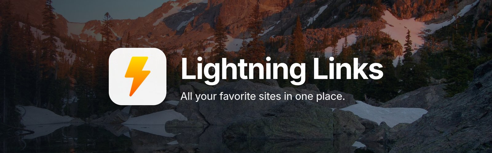
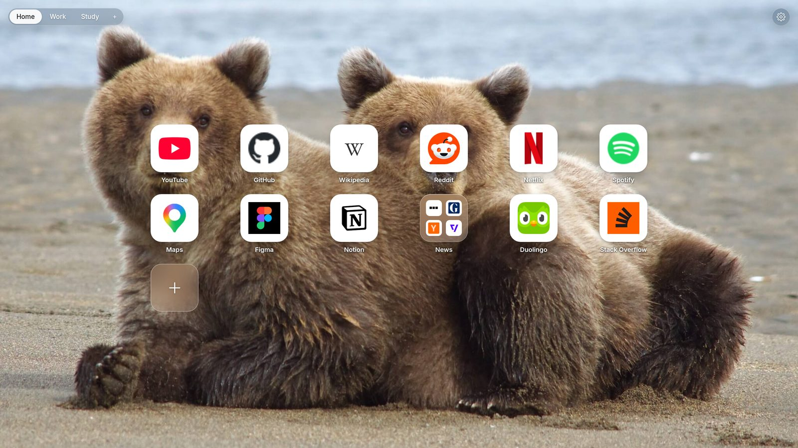
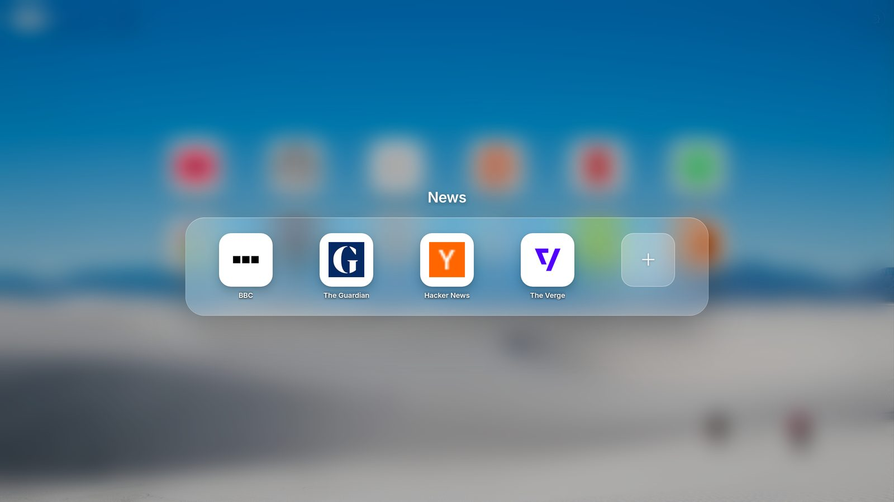
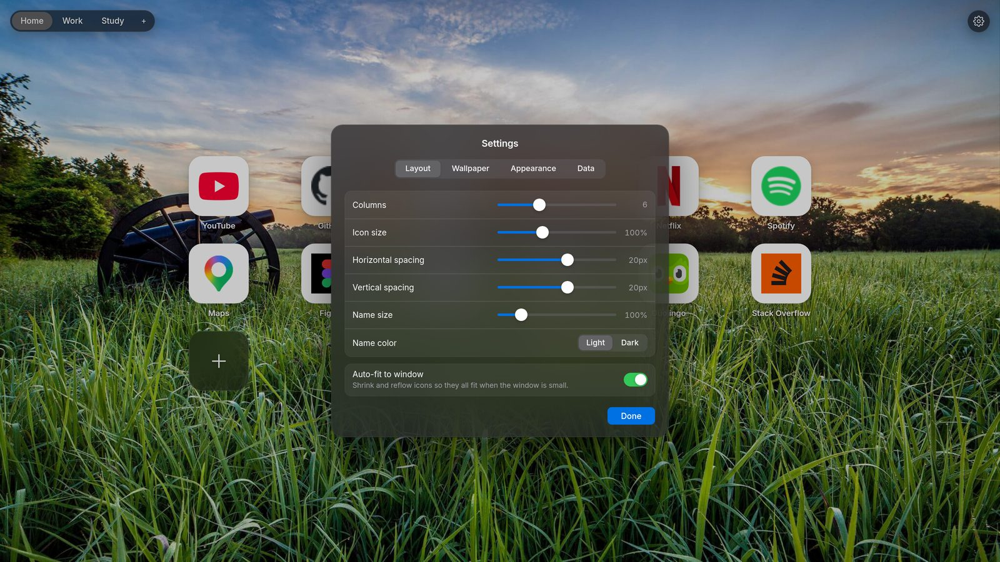

<p align="center">
  
</p>

<p align="center">
  A new tab page for Chrome and Edge that shows your favorite sites as a grid of icons.
  <br>
  <b>No account. No subscription. No analytics. No AI.</b>
</p>

<p align="center">
  
  
  <a href="https://chromewebstore.google.com/detail/lightning-links-fast-new/hkogifdjalfafkapopbpmjdkploifkbc"></a>
  <a href="LICENSE.txt"></a>
</p>

<p align="center">
  
</p>

## 💡 Why

I used generic new tab extensions for years. Over time they picked up AI assistants, clocks, notes and "focus modes" that moved my shortcuts around and broke my muscle memory. Changing the background became a paid feature. I wanted the simple version back, so I wrote my own.

Lightning Links does one job: you open a tab, you click, and in less than a second you're on the site you want.

## 🚀 Install

<p align="center">
  <a href="https://chromewebstore.google.com/detail/lightning-links-fast-new/hkogifdjalfafkapopbpmjdkploifkbc">
    
  </a>
</p>

<p align="center">
  Enjoying it? Don't forget to leave a ⭐ rating and a comment on the store page.
</p>

## ✨ What it does

| | |
|---|---|
| 🧩 **Lightnings** | Each site is an app-style icon with its name underneath. Drag one to move it; the others slide aside to show where it will land. |
| 📁 **Folders** | Hold a lightning over another one to put them in a folder, like on a phone. Click the folder to open it. |
| 🗂️ **Workspaces** | Up to five tabs at the top (Home, Work, Study…), each with its own lightnings. Drag to reorder; right-click to rename or delete. |
| 🖱️ **Right-click menu** | Open a site in a new tab or in Incognito, copy its link, edit or delete it. Folders can open all their links at once. |
| 📐 **Layout** | Columns, icon size, horizontal and vertical spacing (negative values pull icons together) and name size. |
| 🪟 **Auto-fit** | In a small or half-screen window, the lightnings shrink, and drop a column only if they have to, so you never need to scroll. You can turn this off. |
| 🏞️ **Backgrounds** | Starts on a soft solid color you can change. Seven photos are included, or upload your own. |
| 🌍 **Languages** | English, Spanish, Portuguese, French, German, Italian, Russian, Polish, Romanian, Japanese, Chinese, Turkish and Arabic. |
| 👋 **First-run welcome** | New installs pick a language and their first sites from the most popular ones, or skip it. |
| 🌗 **Light and Dark** | Light by default; switch to Dark in Settings. |
| 📴 **Offline icons** | With *Save icons for offline use* on, each icon is stored locally, so the page looks right without a connection. |
| 💾 **Backup** | Export everything (links, folders, workspaces, layout, background and saved icons) to one JSON file, and import it on another computer. |

<p align="center">
  
  
</p>

## 🔒 Privacy

Everything is stored in your browser's `localStorage`, and there is no server. The only network requests are for icons: Google's favicon service receives the domain of each saved link, and custom icons are loaded from the sites that host them. Nothing is sent to the developer.

What the permissions are for:

- `google.com` and `gstatic.com`: site icons come from Google's favicon service when you don't set one yourself.
- *All sites* (optional): asked for only when you turn on offline icons, so icons hosted on other sites can be saved too. If you decline, Google-hosted icons are still saved.

## 💬 Tips

- **Keep your background small.** Uploaded pictures are scaled down to about screen size and compressed, but a lighter file still loads faster. [Squoosh](https://squoosh.app/), free and by Google, works well.
- **Custom icons.** Paste any image URL into *Icon URL* when adding a site. The icon cell is square, so square images look best.
- **Storage.** Browsers give each extension about 5 MB of `localStorage`. If it fills up, offline icons are dropped first so your links are always kept.

## 🛠️ Development

Plain HTML, CSS and JavaScript. There are no dependencies and no build step: edit a file, then reload the new tab.

```
newtab.html     page markup
init.js         runs before first paint: applies background, theme and layout from storage
script.js       the rest of the page
lib/            logic with little or no DOM access (layout math, data model, icon cache, storage, translations)
locales/        one file per language; only the chosen one is loaded
ui/             drag and drop, folder panel, first-run welcome
tests/          unit tests for lib/
```

Run the tests with Node 18 or newer:

```
node --test tests/*.test.js
```

## 🤝 Contributing

Bug reports and ideas are welcome. Please [open an issue](https://github.com/jp-alves/lightning-links/issues). The project aims to stay small, so new features need to fit a page you look at for half a second before clicking somewhere else.

## 🙏 Credits

- Background photos: **National Park Service**, from their [Find Your Park](https://flic.kr/s/aHsmB3hfLR) album on Flickr.
- Language flags: **[flag-icons](https://github.com/lipis/flag-icons)** by Panayiotis Lipiridis, MIT License, included as `icons/flags.webp` (`icons/flags-LICENSE.txt`).
- Font: **[Inter](https://rsms.me/inter/)** by Rasmus Andersson, included in `fonts/` under the SIL Open Font License 1.1 (`fonts/OFL.txt`).

## 📄 License

[MIT](LICENSE.txt)
