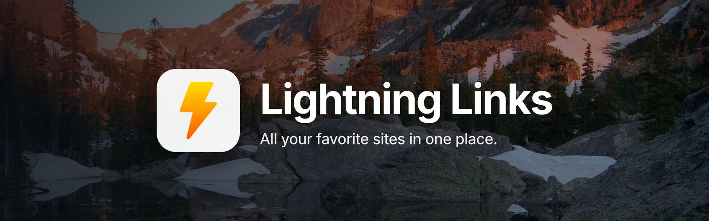
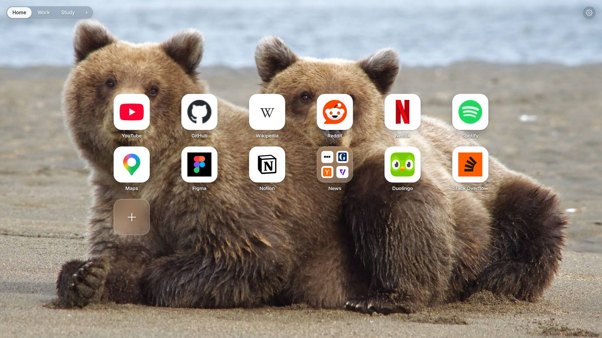
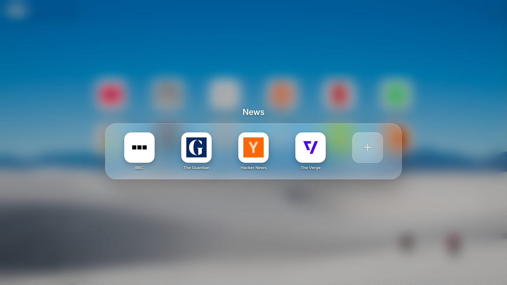
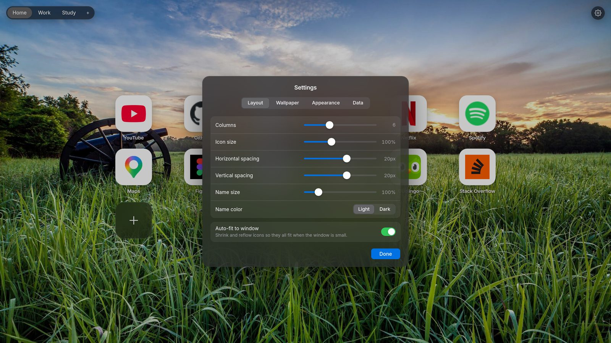

<p align="center">
  
</p>

<p align="center">
  A new tab page for Chrome and Edge that shows your favorite sites as a grid of icons.
  <br>
  <b>No account. No subscription. No analytics. No AI.</b>
</p>

<p align="center">
  
  
  <a href="LICENSE.txt"></a>
</p>

<p align="center">
  
</p>

## 💡 Why

I used **Speed Dial 2** for years. Over time it picked up an AI assistant, clocks, notes and a "focus mode" that moved the dials around and broke my muscle memory. Changing the background became a paid feature. I wanted the old version back, so I wrote my own.

Lightning Links does one job: you open a tab, you click, and in less than a second you're on the site you want.

## ✨ What it does

| | |
|---|---|
| 🧩 **Lightnings** | Each site is an app-style icon with its name underneath. Drag one to move it; the others slide aside to show where it will land. |
| 📁 **Folders** | Hold a lightning over another one to put them in a folder, like on a phone. Click the folder to open it. |
| 🗂️ **Workspaces** | Up to five tabs at the top (Home, Work, Study…), each with its own lightnings. Drag to reorder; right-click to rename or delete. |
| 🖱️ **Right-click menu** | Open a site in a new tab or in Incognito, copy its link, edit or delete it. Folders can open all their links at once. |
| 📐 **Layout** | Columns, icon size, horizontal and vertical spacing (negative values pull icons together) and name size. |
| 🪟 **Auto-fit** | In a small or half-screen window, the lightnings shrink, and drop a column only if they have to, so you never need to scroll. You can turn this off. |
| 🏞️ **Wallpapers** | Five photos are included, or upload your own. |
| 🌗 **Light and Dark** | Light by default; switch to Dark in Settings. |
| 📴 **Offline icons** | With *Save icons for offline use* on, each icon is stored locally, so the page looks right without a connection. |
| 💾 **Backup** | Export everything (links, folders, workspaces, layout, wallpaper and saved icons) to one JSON file, and import it on another computer. |

<p align="center">
  
  
</p>

## 🚀 Install

To install from the source:

1. Download or clone this repository.
2. Go to `chrome://extensions` (or `edge://extensions`).
3. Turn on **Developer mode**.
4. Click **Load unpacked** and pick the project folder.
5. Open a new tab.

To update, pull the latest code and click the reload button on the extension's card.

## 🔒 Privacy

Everything is stored in your browser's `localStorage`. Nothing is sent anywhere, and there is no server.

What the permissions are for:

- `storage`: saving your links and settings.
- `google.com` and `gstatic.com`: site icons come from Google's favicon service when you don't set one yourself.
- *All sites* (optional): asked for only when you turn on offline icons, so icons hosted on other sites can be saved too. If you decline, Google-hosted icons are still saved.

## 💬 Tips

- **Keep your wallpaper small.** Uploaded pictures are scaled down to about screen size and compressed, but a lighter file still loads faster. [TinyPNG](https://tinypng.com/) works well.
- **Custom icons.** Paste any image URL into *Icon URL* when adding a site. The icon cell is square, so square images look best.
- **Storage.** Browsers give each extension about 5 MB of `localStorage`. If it fills up, offline icons are dropped first so your links are always kept.

## 🛠️ Development

Plain HTML, CSS and JavaScript. There are no dependencies and no build step: edit a file, then reload the new tab.

```
newtab.html     page markup
init.js         runs before first paint: applies wallpaper, theme and layout from storage
script.js       the rest of the page
lib/            logic with no DOM access (layout math, data model, icon cache, storage)
ui/             drag and drop, folder panel
tests/          unit tests for lib/
```

Run the tests with Node 18 or newer:

```
node --test tests/*.test.js
```

## 🤝 Contributing

Bug reports and ideas are welcome. Please [open an issue](https://github.com/jp-alves/lightning-links/issues). The project aims to stay small, so new features need to fit a page you look at for half a second before clicking somewhere else.

## 🙏 Credits

- Wallpapers: **National Park Service**, from their [Find Your Park](https://flic.kr/s/aHsmB3hfLR) album on Flickr.
- Font: **[Inter](https://rsms.me/inter/)** by Rasmus Andersson, included in `fonts/` under the SIL Open Font License 1.1 (`fonts/OFL.txt`).

## 📄 License

[MIT](LICENSE.txt)
